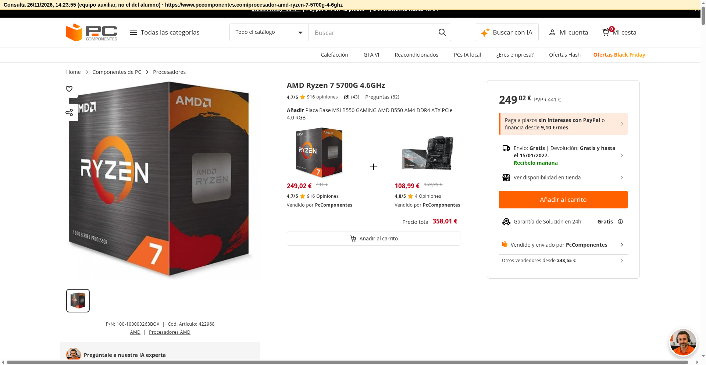
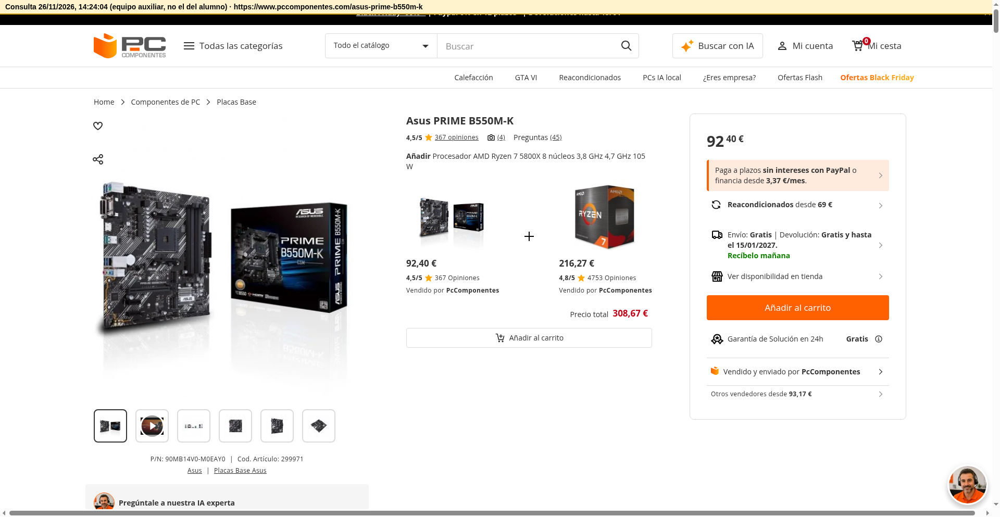
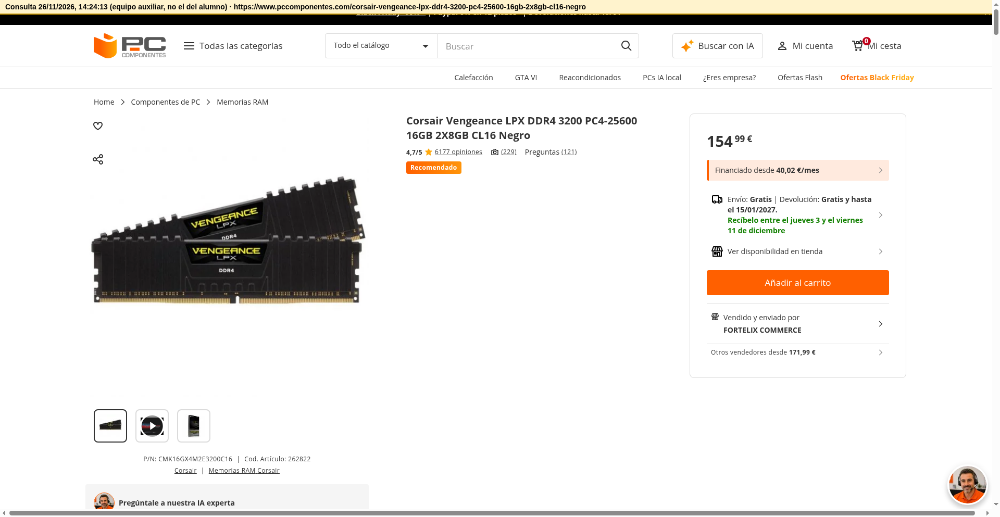
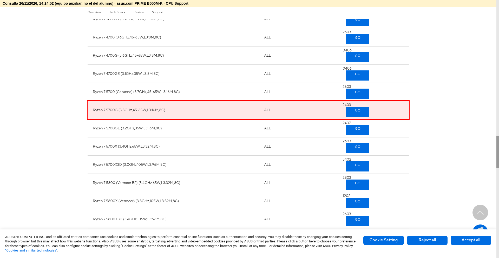
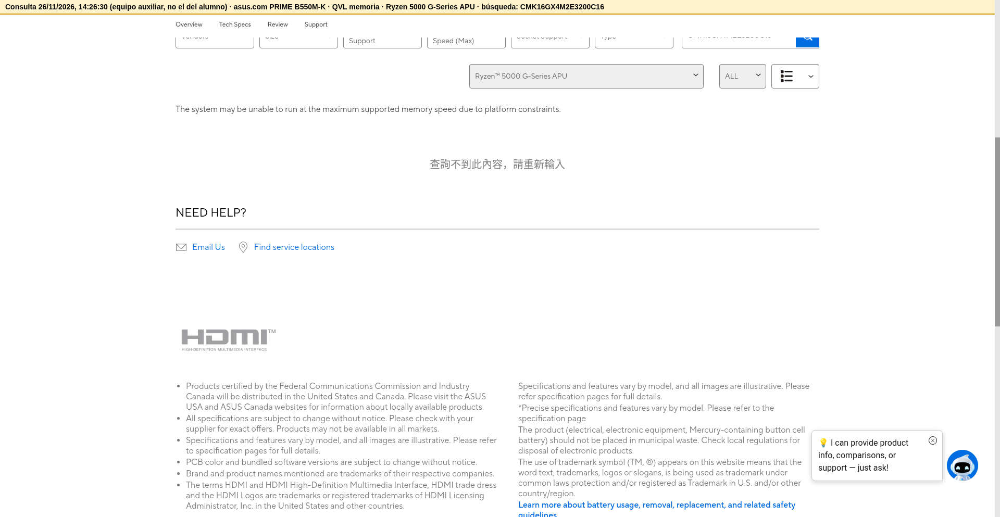
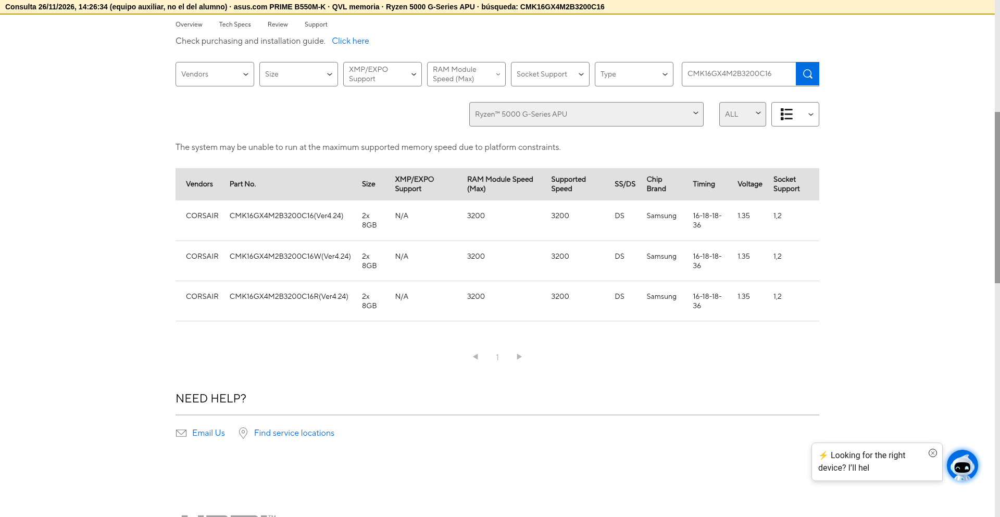
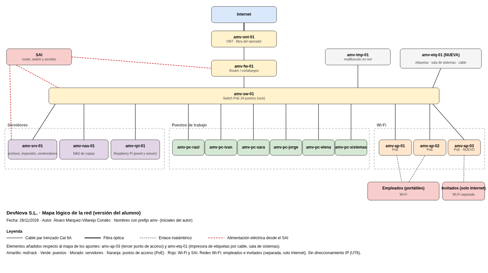

# UT2. Equipar DevNova

| | |
|---|---|
| **Alumno/a** | Álvaro Márquez-Villarejo Condés |
| **Primer apellido** | Márquez-Villarejo (16 letras) |
| **Puesto asignado** | Administración y facturación (Jorge) |
| **Presupuesto máximo de la torre** | 850 € − 10 € × 16 = **690 €** |
| **Sistema operativo de mi equipo** | Pendiente (ver apartado 1) |
| **Vídeo explicativo** | No entregado |

**Estado de esta entrega (26/11/2026):** entrega parcial. Incluye los apartados 2, 3 (menos 3.4), 4 y 5, con fuentes y capturas. No incluye el vídeo ni los datos de mi propio equipo (apartado 1 y apartado 3.4), porque esos datos deben salir de mi ordenador y no los he sustituido por datos de otro equipo. Las capturas de tiendas y de ASUS se hicieron en un equipo auxiliar, que no es el mío: el banner de cada captura lo indica.

## Índice

1. [Radiografía de mi equipo](#1-radiografía-de-mi-equipo)
2. [Ficha de configuración de los equipos](#2-ficha-de-configuración-de-los-equipos)
3. [Comprobación con la documentación del fabricante](#3-comprobación-con-la-documentación-del-fabricante)
4. [La red de la oficina](#4-la-red-de-la-oficina)
5. [Seguridad y medio ambiente](#5-seguridad-y-medio-ambiente)
6. [Fuentes](#fuentes)
7. [Declaración de uso de IA](#declaración-de-uso-de-ia)
8. [Historial de commits](#historial-de-commits)

## 1. Radiografía de mi equipo

**Pendiente.** Inventario, SMART, MAC, firmware, temperaturas y periférico se miden en mi ordenador con las herramientas de los apuntes (HWiNFO o inxi, `msinfo32`, etc.). Este apartado queda sin rellenar hasta tener esas mediciones reales. No se incluyen datos de ningún otro equipo.

## 2. Ficha de configuración de los equipos

### 2.1. Ficha completa de mi puesto

**Puesto:** Administración y facturación (Jorge)
**Presupuesto máximo (solo torre, IVA incluido):** 690,00 €

| Componente | Modelo elegido | Precio (€) | Tienda / enlace | Justificación |
|---|---|--:|---|---|
| Procesador (CPU) | AMD Ryzen 7 5700G | 249,02 | [PcComponentes](https://www.pccomponentes.com/procesador-amd-ryzen-7-5700g-4-6ghz) | 8 núcleos y 16 hilos para ofimática, facturación y varias aplicaciones a la vez. Gráficos Radeon integrados: no hace falta tarjeta gráfica. |
| Placa base | ASUS PRIME B550M-K | 92,40 | [PcComponentes](https://www.pccomponentes.com/asus-prime-b550m-k) | Socket AM4 y DDR4, formato micro-ATX, dos ranuras M.2 y salidas de vídeo para el APU. |
| Memoria RAM | Corsair Vengeance LPX 16 GB (2×8 GB) DDR4-3200 CL16, ref. CMK16GX4M2E3200C16 | 154,99 | [PcComponentes](https://www.pccomponentes.com/corsair-vengeance-lpx-ddr4-3200-pc4-25600-16gb-2x8gb-cl16-negro) | Dos módulos para doble canal (el APU usa la memoria también como memoria de vídeo). 16 GB bastan para un puesto de administración. |
| Almacenamiento | ADATA LEGEND 710 512 GB (M.2 NVMe) | 103,99 | [PcComponentes](https://www.pccomponentes.com/disco-duro-adata-legend-710-m-2-512gb-nvme-nand-gen3x4) | NVMe rápido para arranque y programas. 512 GB sobran para documentos y facturas. |
| Tarjeta gráfica | No lleva | 0,00 | | El 5700G tiene gráficos integrados. |
| Fuente de alimentación | Aisens ASPC-500ATX-SEO 500 W | 18,98 | [PcComponentes](https://www.pccomponentes.com/fuente-alimentacion-aisens-aspc-500atx-seo-500w-atx-2-0-protecciones-ocp-ovp-uvp-sc-opp-otp) | El configurador estima 188 W de consumo, así que 500 W dejan margen. Tiene conector EPS 4+4. |
| Caja | MARS GAMING MC-3TLITE | 45,99 | [PcComponentes](https://www.pccomponentes.com/torre-pc-mars-gaming-mc-3tlite-caja-gaming-microatx-triple-cristal-templado-ventilador-frgb-120mm-negro) | Admite placas micro-ATX y es barata. |
| Refrigeración de la CPU | Wraith Stealth (incluido con el 5700G) | 0,00 | Incluido en la caja del procesador | Ahorra dinero. Ver el aviso de potencia en 2.2. |
| **TOTAL** | | **665,37** | **Presupuesto restante:** | **24,63 €** |

**Periféricos (fuera del presupuesto de la torre):**

| Componente | Modelo elegido | Precio (€) | Tienda / enlace | Justificación |
|---|---|--:|---|---|
| Monitor | Samsung LS24D400GSUXXE 24" Full HD, 100 Hz, IPS | 139,99 | [PcComponentes](https://www.pccomponentes.com/monitor-samsung-ls24d400gsuxxe-24-full-hd-100-hz-ips-5-ms-ajustable-en-altura) | Panel IPS y ajustable en altura, adecuado para trabajar muchas horas con hojas de cálculo. |

Fecha de consulta de los precios: 26/11/2026 (entre las 14:21 y las 14:27, hora de España). Los precios de la tienda cambian en pocos minutos: el 5700G figuraba a 247,73 € a las 14:21 en el texto de la ficha y a 249,02 € en el panel de compra a las 14:23, y uso el segundo.

PDF del configurador: [docs/configurador-devnova-jorge-admin.pdf](docs/configurador-devnova-jorge-admin.pdf). Se generó con el botón de imprimir del configurador, con mi nombre y mi puesto, en un equipo auxiliar (no es mi ordenador).

**Capturas de las páginas de producto (con precio, fecha y hora visibles en el banner superior):**

### 2.2. Avisos del configurador

El configurador da el resultado «Compatible, pero hay que revisar» con 188 W de 500 W. El PDF del configurador conserva sus avisos genéricos tal como salieron; esta tabla indica cuáles se han resuelto con el manual y cuáles siguen abiertos:

| Aviso | Qué significa | Qué he hecho |
|---|---|---|
| BIOS mínima 2403 para el 5700G | ASUS admite el 5700G desde la BIOS 2403. Una placa de stock antiguo puede no arrancar con este APU hasta actualizar la BIOS. | Lo dejo anotado para el pedido: pedir la placa con la BIOS actualizada o actualizarla antes de montar el equipo. Fuente: lista de CPU de ASUS (3.1). |
| Refrigeración: el Wraith Stealth soporta 65 W y el 5700G puede llegar a ~88 W en picos | En carga alta y sostenida el disipador de serie se queda corto. | Para ofimática y facturación la carga es baja, así que lo mantengo para ahorrar. Si hubiera cargas largas, habría que añadir un disipador mayor con los 24,63 € que sobran. |
| Plataforma AM4 antigua | AM4 ya no recibe procesadores nuevos. | Es una decisión de precio: con 690 € no hay margen para AM5 con memoria DDR5. |
| Activar XMP en la BIOS | Por defecto la memoria arranca a la velocidad base. | Activar el perfil en la BIOS al montar el equipo. |
| Módulos de RAM: el configurador dice «normalmente A2 y B2» | El configurador no conoce la placa exacta. | **Resuelto con el manual:** DIMM_A2 y DIMM_B2 (apartado 3.3). |
| Salidas de vídeo sin verificar | El configurador no tiene esos datos de la placa. | **Resuelto con el manual** (E16604, especificaciones): la placa tiene 1 × D-Sub, 1 × DVI-D y 1 × HDMI 2.1. El monitor Samsung tiene 1 × HDMI 1.4 y 1 × DisplayPort 1.2 (ficha de PcComponentes), así que se conectan por HDMI. |
| Longitud máxima de la fuente en la caja | El configurador no tiene ese dato. | **Sigue pendiente:** hay que mirar el manual de la caja MC-3TLITE antes de comprar. La caja es micro-ATX y la fuente es ATX estándar. |

### 2.3. El resto de la oficina

Todas las configuraciones se validaron en el configurador con precios del 26/11/2026 en PcComponentes. Cada línea es una unidad, salvo la memoria de Iván, Sara y Raúl: Kingston FURY Beast DDR4-3200 CL16 de 16 GB (ref. KF432C16BB1/16) se vende en módulos sueltos, así que cada torre lleva 2 unidades (2 × 189,99 €).

#### Desarrollo móvil (Iván) y desarrollo backend y web (Raúl): misma configuración

El enunciado da el «presupuesto base de la torre» para los cuatro puestos, incluido el de desarrollo móvil, y no pide un portátil. Por eso Iván lleva una torre igual que Raúl.

| Componente | Modelo | Precio (€) | Justificación |
|---|---|--:|---|
| CPU | AMD Ryzen 7 5700G | 249,02 | 8 núcleos y 16 hilos para compilar, emular Android y ejecutar contenedores. |
| Placa | MSI B550-A PRO | 139,98 | ATX, AM4 y DDR4, con más ranuras de expansión que la micro-ATX. |
| RAM | 2 × Kingston FURY Beast 16 GB DDR4-3200 CL16 | 379,98 | 32 GB para emulador, IDE y bases de datos a la vez. |
| Almacenamiento | Kingston NV3 1 TB NVMe | 156,22 | Espacio para proyectos, imágenes y máquinas virtuales. |
| Fuente | Mars Gaming MPB650SIM 650 W | 63,93 | Modular y con margen. |
| Caja | Mars Gaming MC-PULSAR | 46,98 | ATX, buena ventilación. |
| Refrigeración | Wraith Stealth incluido | 0,00 | |
| **Total torre** | | **1.036,11** | |

#### Diseño de interfaces (Sara)

| Componente | Modelo | Precio (€) | Justificación |
|---|---|--:|---|
| CPU | Intel Core i5-12600KF | 201,19 | 10 núcleos para edición de imagen y vídeo. |
| Placa | ASUS PRIME B760M-K D4 | 89,00 | LGA1700 con DDR4. |
| RAM | 2 × Kingston FURY Beast 16 GB DDR4-3200 CL16 | 379,98 | 32 GB para Figma, Photoshop y navegador a la vez. |
| Almacenamiento | Kingston NV3 1 TB NVMe | 156,22 | |
| Tarjeta gráfica | Gigabyte Radeon RX 7600 GAMING OC 8 GB | 489,99 | Aceleración de diseño y vídeo. Sustituye a la RTX 4060, que figura sin fecha de entrada. |
| Fuente | Mars Gaming MPB650SIM 650 W | 63,93 | |
| Refrigeración | Mars Gaming MCPU-X26PRO | 39,89 | El 12600KF no lleva disipador. |
| Caja | Mars Gaming MC-PULSAR | 46,98 | |
| **Total torre** | | **1.467,18** | Configurador: «ok», consumo estimado 415 W. |

Monitor de Sara: Philips 27E1N1600AE 27" QHD IPS con USB-C, 159,90 € (más resolución y espacio de trabajo para diseño).

#### Administración (Elena)

Misma configuración que la del apartado 2.1: 665,37 € por torre y un monitor Samsung de 139,99 €.

#### Resumen de la compra

| Puesto | Unidades | Precio por torre | Monitores | Subtotal |
|---|:--:|--:|--:|--:|
| Desarrollo móvil (Iván) | 1 | 1.036,11 | 1 × 139,99 | 1.176,10 |
| Diseño de interfaces (Sara) | 1 | 1.467,18 | 1 × 159,90 | 1.627,08 |
| Administración (Jorge y Elena) | 2 | 665,37 | 2 × 139,99 | 1.610,72 |
| Desarrollo backend y web (Raúl) | 1 | 1.036,11 | 2 × 139,99 | 1.316,09 |
| **Total de la compra** | | | | **5.729,99** |

Cuatro de los componentes elegidos tienen plazos de entrega largos en la tienda (placa MSI B550-A PRO, 10 a 14 de diciembre; kit de memoria Corsair, 3 a 11 de diciembre; monitor Samsung, 3 a 11 de diciembre; i5-12600KF, 1 a 3 de diciembre). Es una propuesta académica, no una compra.

## 3. Comprobación con la documentación del fabricante

Placa base elegida: ASUS PRIME B550M-K.

### 3.1. Procesador

Versión mínima de BIOS para mi procesador: **2403** (Ryzen 7 5700G, «Validated since PCB: ALL»). Para comparar, el 5800X se admite desde la 1202.

### 3.2. Memoria

**Mi kit no está en la QVL.** Busqué la referencia exacta (CMK16GX4M2E3200C16) en la lista de «Ryzen 5000 G-Series APU», que es la que corresponde al 5700G, y ASUS no la tiene. La QVL sí incluye la variante CMK16GX4M2B3200C16 (Ver4.24) y sus versiones W y R: es el mismo tipo de kit con otra referencia. Esa variante estaba a 100,99 € en PcComponentes, pero figuraba sin fecha de entrada el 26/11/2026, y por eso elegí el kit que sí se podía comprar.

**Riesgo:** que la placa no arranque a 3200 MHz, que haya que bajar la velocidad o que el equipo sea inestable. No es seguro que falle: que no esté en la QVL significa que ASUS no lo ha probado.

**Qué haría:** actualizar primero la BIOS (necesaria de todos modos para el 5700G), activar el perfil XMP y probar la memoria con MemTest86 durante varias pasadas. Si dan errores o no arranca, bajar a 3000 o 2666 MHz, o cambiar a un kit de la QVL, por ejemplo el CMK16GX4M2B3200C16R cuando vuelva a haber stock.

### 3.3. Manual de la placa

Manual consultado: *PRIME B550M-K User Manual*, E16604, primera edición, abril de 2020. Descargado de ASUS: <https://dlcdnets.asus.com/pub/ASUS/mb/SocketAM4/PRIME_B550M-K/E16604_PRIME_B550M-K_UM_WEB.pdf> (diagrama de ranuras en la página 1-8, página 16 del PDF).

| | |
|---|---|
| Ranuras para doble canal | Con 2 módulos, **DIMM_A2 y DIMM_B2**. El canal A es DIMM_A1 y A2, y el canal B es DIMM_B1 y B2. |
| Ranuras M.2 que comparten recursos | El manual **no indica** que ninguna ranura M.2 comparta ancho de banda con puertos SATA o PCIe. Sí indica que M.2_1 va a la CPU (PCIe 4.0 x4, y 3.0 con un APU serie G; admite 2242, 2260, 2280 y 22110, en PCIe o SATA) y que M.2_2 va al chipset (PCIe 3.0 x4 o SATA; admite 2242, 2260 y 2280). |

### 3.4. Mi equipo frente al puesto

**Pendiente.** Depende de los datos reales de mi equipo (apartado 1) y del manual de su modelo exacto.

## 4. La red de la oficina

### 4.1. Interpretación del mapa de DevNova

Fuente: mapa lógico del capítulo 14 de los apuntes de la UT2 (14.6).

1. **Tipo de red y topología física:** es una **LAN**, porque está en un único edificio. La topología física es en **estrella** alrededor del switch (deducido del mapa, ya que todo cuelga del switch).
2. **Punto único de fallo y consecuencias:** el **switch PoE de 24 puertos**. Si falla, se cae toda la red de la oficina: los puestos, el servidor, el NAS y la impresora se quedan sin conexión, y los puntos de acceso además pierden la alimentación PoE, así que se cae también el Wi-Fi.
3. **Medios de transmisión y dónde se usa cada uno:** **cable de par trenzado Cat 6A** para los puestos, los servidores y la impresora, y para los puntos de acceso, que además se alimentan por él (PoE). **Fibra óptica**, según la leyenda del mapa, en el acceso a Internet a través de la ONT. **Wi-Fi** para los portátiles de los empleados y para los invitados.
4. **Por qué la red de invitados está separada:** por seguridad. Los apuntes la presentan como una red separada y solo con salida a Internet, de modo que un dispositivo ajeno no llega a los puestos, al servidor ni a los datos de la empresa.

### 4.2. Mi mapa lógico

Editable: [docs/mapa-logico-devnova.drawio](docs/mapa-logico-devnova.drawio). Incluye todos los dispositivos del mapa de los apuntes, un punto de acceso más (amv-ap-03) y una impresora de etiquetas por cable en la sala de sistemas (amv-etq-01). Los nombres llevan el prefijo **amv-** (Álvaro Márquez-Villarejo). Cada puesto, servidor, punto de acceso e impresora tiene su enlace propio al switch, y el SAI alimenta al router, al switch y al servidor (líneas rojas). Título, fecha, autor y leyenda figuran en el propio mapa.

### 4.3. Cableado

- **Categoría de cable para las tomas:** **Cat 6A**. Los apuntes (13.5) la recomiendan en instalaciones nuevas: admite 10 Gbps hasta 100 m, así que la instalación no se queda corta en unos años.
- **Dispositivos que necesitan PoE:** los **tres puntos de acceso Wi-Fi** (AP-01, AP-02 y el AP adicional). El switch tiene que ser PoE y tener presupuesto de potencia suficiente. La impresora de etiquetas va por cable normal y no necesita PoE.

## 5. Seguridad y medio ambiente

### 5.1. Mi puesto de estudio

Describo mi puesto cuando estudio con el ordenador. Son mis observaciones, sin mediciones con cinta métrica. Los cinco puntos son los de la guía del INSST (Real Decreto 488/1997 y su guía técnica de pantallas de visualización).

| Punto de la guía del INSST | Situación en mi puesto | ¿Cumple? |
|---|---|:--:|
| Distancia y altura de la pantalla | Tengo la pantalla a una distancia y a una altura cómodas. No he medido los centímetros. | Sí, sin medir |
| Silla y apoyo de los pies | La silla tiene apoyo lumbar y apoyo los pies. | Sí |
| Posición de teclado y ratón | Uso teclado y ratón externos y quedan a la altura de los codos. | Sí |
| Iluminación y reflejos | No tengo reflejos en la pantalla. | Sí |
| Pausas | Hago pausas cuando me siento cansado, no a horas fijas. La guía recomienda pausas periódicas, así que este punto es mejorable. | Parcial |

Mejoras propuestas:

1. Usar un filtro de luz azul en la pantalla, para estudiar con más comodidad visual.
2. Mejorar la iluminación del entorno de la habitación, para que la luz ambiente acompañe a la de la pantalla.

### 5.2. Los portátiles viejos de DevNova

Los tres portátiles se tratan como residuos de aparatos eléctricos y electrónicos (RAEE), según el Real Decreto 110/2015, modificado por el Real Decreto 27/2021. Antes de entregarlos hay que borrar los datos de los clientes de forma segura: Secure Erase o Sanitize en los SSD, borrado de la clave de BitLocker o LUKS si el disco está cifrado, sobrescritura en los discos duros y destrucción física si el disco está dañado o tiene datos muy sensibles. El borrado se documenta. Después se entregan a un gestor de residuos autorizado, que da el certificado de recogida, o se reutilizan o donan una vez borrados. Si se compran equipos nuevos, el distribuidor tiene que recoger el viejo 1 a 1.

## Fuentes

- Enunciado de la tarea UT2 «Equipar DevNova» y apuntes UT2 (capítulos 13 y 14), aula virtual DAM: <https://aulasfp2627.castillalamancha.es/mod/assign/view.php?id=116513> y <https://aulasfp2627.castillalamancha.es/pluginfile.php/151796/mod_resource/content/1/UT2_Componentes_del_sistema_inform%C3%A1tico.html>
- Configurador de DevNova (del aula virtual), consultado el 26/11/2026.
- ASUS, lista de CPU compatibles de la PRIME B550M-K: <https://www.asus.com/motherboards-components/motherboards/prime/prime-b550m-k/helpdesk_cpu?model2Name=PRIME-B550M-K>
- ASUS, QVL de memoria de la PRIME B550M-K: <https://www.asus.com/motherboards-components/motherboards/prime/prime-b550m-k/helpdesk_qvl_memory?model2Name=PRIME-B550M-K>
- ASUS, especificaciones: <https://www.asus.com/motherboards-components/motherboards/prime/prime-b550m-k/techspec/>
- ASUS, manual E16604 de la PRIME B550M-K (enlace en 3.3).
- PcComponentes (precios y fichas, consultados el 26/11/2026): enlaces en las tablas del apartado 2 y, para el resto de la oficina, <https://www.pccomponentes.com/kingston-fury-beast-ddr4-3200-mhz-16-gb-cl16>, <https://www.pccomponentes.com/procesador-intel-core-i5-12600kf-3-7-ghz>, <https://www.pccomponentes.com/asus-prime-b760m-k-d4>, <https://www.pccomponentes.com/placa-base-msi-b550-a-pro-b550-am4-ddr4-atx-gigabit-lan-m-2-crossfirex>, <https://www.pccomponentes.com/mars-gaming-mpb650sim-fuente-alimentacion-modular-atx-650w-7-anos-garantia-80plus-bronze-negro>, <https://www.pccomponentes.com/mars-gaming-mc-pulsar-caja-gaming-atx-pantalla-lcd-doble-cristal-templado-frontal-y-lateral-blanco>, <https://www.pccomponentes.com/ventilador-cpu-refrigeracion-aire-mars-gaming-socket-intel-lga-amd-158mm-mcpu-x26pro-dual-tower-2x120mm>, <https://www.pccomponentes.com/tarjeta-grafica-gigabyte-radeon-rx-7600-gaming-oc-8gb-gddr6>, <https://www.pccomponentes.com/disco-duro-kingston-nv3-1tb-disco-ssd-6000mb-s-nvme-pcie-4-0-m-2-gen4-2280-3d-nand>, <https://www.pccomponentes.com/monitor-philips-serie-1000-27e1n1600ae-27-led-ips-qhd-100hz-usb-c>
- INSST, Real Decreto 488/1997 y guía técnica de pantallas de visualización.
- Real Decreto 110/2015 (RAEE), modificado por el Real Decreto 27/2021.

## Declaración de uso de IA

He usado un asistente de IA para preparar esta tarea: buscar y contrastar fichas y precios, comprobar la compatibilidad en el configurador y en la documentación de ASUS, generar el PDF del configurador, dibujar el mapa lógico y redactar este README a partir de esas fuentes. Todo lo que figura en el README se ha contrastado con las fuentes citadas. La descripción de mi puesto de estudio (5.1) y las mejoras que propongo son mías: se las conté al asistente y él las ordenó en la tabla. El apartado 1, el apartado 3.4 y el vídeo no los ha generado la IA y quedan pendientes.

## Historial de commits

Pendiente. Se incluirá aquí la salida real de `git log --oneline` del repositorio, sin añadir commits que no existan.
